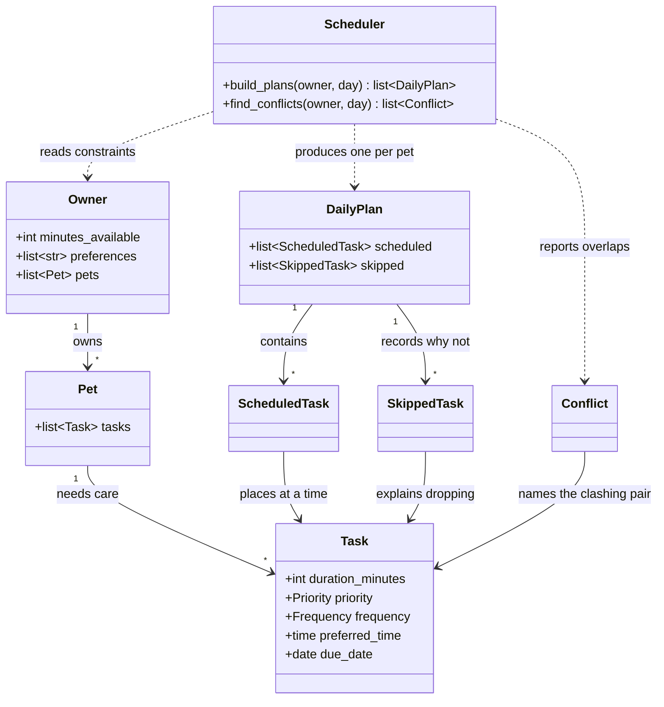

# PawPal+ 🐾

A pet care planning assistant. You tell PawPal+ about your pets, the care tasks
they need, and how much time you actually have today — it builds a timed daily
plan that fits, and explains every choice it made.

Built as a Streamlit app on top of a standalone Python logic layer, so the same
scheduler runs from the browser, the terminal, and the test suite.

## Scenario

A busy pet owner needs help staying consistent with pet care. They want an
assistant that can:

- Track pet care tasks (walks, feeding, meds, enrichment, grooming, etc.)
- Consider constraints (time available, priority, owner preferences)
- Produce a daily plan and explain why it chose that plan

## Features

**Planning**

- **Timed daily plans.** Every scheduled task gets a real start and end time,
  not just an ordering.
- **One shared timeline across pets.** The owner has one pair of hands, so no
  two tasks ever overlap — even for different pets.
- **One shared time budget.** All pets draw from the minutes you have today.
  Priority is compared across the whole household, so the cat's medication
  outranks the dog's nail trim.
- **Fixed-time anchors.** A task can be pinned to a clock time (medication at
  09:00), and the scheduler fills the gaps around it.
- **Explained decisions.** Every task carries the reason it was scheduled where
  it was, and every dropped task carries the reason it did not fit.

**Algorithms**

- **Sorting by time** — fixed times in chronological order, flexible tasks last.
- **Sorting by priority** — highest first, shortest duration breaking ties.
- **Filtering** — by pet, completion status, priority, frequency or due date.
- **Daily and weekly recurrence** — completing a task queues its next
  occurrence; weekly tasks keep their weekday even when completed late.
- **Conflict warnings** — every pair of fixed-time tasks whose windows overlap
  is reported before the plan is shown, with what PawPal+ decided about it.
- **Owner preferences** — keyword matches break ties between equal-priority
  tasks, without ever outranking a higher-priority task.

## Getting started

### Setup

```bash
python -m venv .venv
source .venv/bin/activate  # Windows: .venv\Scripts\activate
pip install -r requirements.txt
```

### Running

```bash
# The Streamlit app (the main interface):
streamlit run app.py

# The CLI demo, which prints a full worked example:
python main.py

# The test suite:
python -m pytest
```

## Project layout

| File | Role |
|------|------|
| `pawpal_system.py` | The logic layer: `Owner`, `Pet`, `Task`, `Scheduler` and the plan/conflict types. Imports no Streamlit |
| `app.py` | The Streamlit UI. Collects input, calls the logic layer, renders results — no scheduling rules of its own |
| `main.py` | CLI demo of every feature, and the source of the sample data the app's "Load example data" button uses |
| `tests/test_pawpal.py` | 72 tests over the logic layer |
| `tests/test_app.py` | 15 tests driving the real Streamlit script through `AppTest` |
| `diagrams/uml_final.mmd` | Final system architecture |
| `diagrams/uml.mmd` | Working class diagram kept in sync during the build |
| `reflection.md` | Design decisions, tradeoffs and AI-collaboration notes |

## Architecture

Dependencies point one way: the UI and the CLI both import the logic layer, and
nothing in the logic layer imports Streamlit. That is what makes the scheduler
testable and lets the same code drive a browser and a terminal.



See [`diagrams/uml_final.mmd`](diagrams/uml_final.mmd) for the complete diagram
with every attribute and method.

## 🖥️ Sample Output

`python main.py` runs four sections. Jordan has 90 minutes, two pets and nine
tasks between them, so the scheduler has to leave some out.

**1. The daily plan**

```
==============================================================
        TODAY'S SCHEDULE - Monday, September 14, 2026         
==============================================================
Owner:      Jordan
Time today: 90 min
Prefers:    walk, play
Pets:       Mochi (dog, Shiba Inu, 3y), Pickle (cat, Tabby, 7y)
Conflicts:  none detected

--------------------------------------------------------------
MOCHI
--------------------------------------------------------------
  08:00-08:30  Morning walk     30 min
               high     why: fixed 08:00 slot you asked for
  08:30-08:40  Breakfast        10 min
               high     why: high priority
  18:00-18:25  Evening walk     25 min
               medium   why: fixed 18:00 slot you asked for

  3 tasks, 65 min of care

  Left out:
    - Brush coat      needs 20 min, only 10 min left of your 90
    - Puzzle feeder   needs 15 min, only 10 min left of your 90

--------------------------------------------------------------
PICKLE
--------------------------------------------------------------
  08:40-08:50  Wet food         10 min
               medium   why: medium priority
  09:00-09:05  Thyroid meds      5 min
               high     why: fixed 09:00 slot you asked for

  2 tasks, 15 min of care

  Left out:
    - Wand play       needs 15 min, only 10 min left of your 90
    - Clip nails      needs 25 min, only 10 min left of your 90

--------------------------------------------------------------
  5 tasks planned, 4 left out, 80/90 min used
```

Both pets are planned against **one** clock, so no two tasks overlap even
across pets. `Brush coat` is weekly and only appears because the demo day is a
Monday. 10 minutes go unused because nothing remaining is short enough to fit —
the scheduler never splits a task.

**2. Sorting and filtering**

```
==============================================================
                    SORTING AND FILTERING                     
==============================================================
Mochi's tasks in the order they were entered:
    18:00  Evening walk     25 min  medium 
      --    Puzzle feeder    15 min  low    
    08:00  Morning walk     30 min  high   
      --    Breakfast        10 min  high   
      --    Brush coat       20 min  medium 

Scheduler.sort_by_time() - fixed times first, unpinned tasks last:
    08:00  Morning walk     30 min  high   
    18:00  Evening walk     25 min  medium 
      --    Puzzle feeder    15 min  low    
      --    Breakfast        10 min  high   
      --    Brush coat       20 min  medium 

Scheduler.sort_by_priority() - highest priority, then shortest:
      --    Breakfast        10 min  high   
    08:00  Morning walk     30 min  high   
      --    Brush coat       20 min  medium 
    18:00  Evening walk     25 min  medium 
      --    Puzzle feeder    15 min  low    

Owner.filter_tasks(pet_name='Pickle') - one pet only:
      --    Wand play        15 min  low    
    09:00  Thyroid meds      5 min  high   
      --    Clip nails       25 min  low    
      --    Wet food         10 min  medium 

Owner.filter_tasks(priority='high') - across every pet:
    08:00  Morning walk     30 min  high   
      --    Breakfast        10 min  high   
    09:00  Thyroid meds      5 min  high   

Owner.filter_tasks(completed=False, due_on=PLANNING_DAY) - due today:
    18:00  Evening walk     25 min  medium 
      --    Puzzle feeder    15 min  low    
    08:00  Morning walk     30 min  high   
      --    Breakfast        10 min  high   
      --    Brush coat       20 min  medium 
      --    Wand play        15 min  low    
    09:00  Thyroid meds      5 min  high   
      --    Clip nails       25 min  low    
      --    Wet food         10 min  medium 
    ^ 'Brush coat' is weekly on Monday, so it appears here but would not
      on any other weekday.
```

**3. Recurring tasks**

```
==============================================================
                       RECURRING TASKS                        
==============================================================
Completed 'Breakfast' (daily) on Mon Sep 14
  -> queued: Breakfast (10 min, high, due Tue Sep 15)
Completed 'Brush coat' (weekly) on Mon Sep 14
  -> queued: Brush coat (20 min, medium, due Mon Sep 21)

Mochi's pending list now carries the next occurrences:
    18:00  Evening walk     25 min  medium 
      --    Puzzle feeder    15 min  low    
    08:00  Morning walk     30 min  high   
      --    Breakfast        10 min  high     due Tue Sep 15
      --    Brush coat       20 min  medium   due Mon Sep 21

Still due on Mon Sep 14 (the follow-ups are not):
    18:00  Evening walk     25 min  medium 
      --    Puzzle feeder    15 min  low    
    08:00  Morning walk     30 min  high   
```

**4. Conflict detection**

```
==============================================================
                      CONFLICT DETECTION                      
==============================================================
Three tasks pinned to overlapping times:
    08:00-08:30  Morning walk    (Mochi)
    08:15-08:25  Insulin shot    (Pickle)
    08:20-08:25  Eye drops       (Pickle)

Scheduler.conflict_warnings() found 3:
    ! 'Morning walk' for Mochi (08:00-08:30) overlaps 'Insulin shot' for Pickle (08:15-08:25) - you cannot be in two places at once
    ! 'Morning walk' for Mochi (08:00-08:30) overlaps 'Eye drops' for Pickle (08:20-08:25) - you cannot be in two places at once
    ! Pickle: 'Insulin shot' (08:15-08:25) overlaps 'Eye drops' (08:20-08:25)

The plan still builds - the loser is skipped, not crashed on:
    kept    08:00  Morning walk (Mochi)
    skipped       Insulin shot (Pickle) - its preferred time overlaps an earlier task
    skipped       Eye drops (Pickle) - its preferred time overlaps an earlier task
```

Note the second warning: `Morning walk` clashes with **both** later tasks. A
naive "compare each task with the next one" check would report only the first
pair and miss `Morning walk` vs `Eye drops`.

## 🧪 Testing PawPal+

```bash
# Run the full test suite:
python -m pytest

# Run with coverage of the logic layer:
python -m pytest --cov=pawpal_system --cov-report=term-missing
```

**What the tests cover** — 87 tests in two files:

`tests/test_pawpal.py` (72 tests) covers the logic layer:

| Area | Examples |
|------|----------|
| Data model | Adding a task grows the list, `mark_complete()` flips status, completed tasks leave `pending_tasks()`, removal by title and by position, zero-duration tasks rejected |
| Sorting | `sort_by_time()` returns fixed times in chronological order with unpinned tasks last and is stable; `sort_by_priority()` ranks by priority then duration; the finished plan itself reads top-to-bottom by clock |
| Filtering | By completion status, pet name, priority, frequency and due date, and that combined criteria must *all* match |
| Recurrence | Completing a daily task queues tomorrow; a weekly task queues the same weekday next week — even when completed late; the follow-up stays out of today's plan; an overdue task stays due; undo removes the follow-up |
| Conflicts | Detected across pets and within one pet; back-to-back tasks do *not* conflict; every overlapping pair is reported, not just adjacent ones; completed and unpinned tasks never conflict; the plan still builds and skips the loser with a reason |
| Scheduling | Priority order, the shared time budget, fixed-time anchors, gap-filling before an anchor, anchors outside the day window, preferences breaking ties, and priority compared *across* pets |
| Edge cases | Pet with no tasks, owner with no pets, zero minutes available, a task longer than the day window, a task longer than the budget, two pets sharing a name, planning is side-effect free and deterministic |

`tests/test_app.py` (15 tests) drives the real Streamlit script through
`AppTest`, covering what the logic tests cannot: that a pet added in the browser
survives a rerun, that duplicate task titles do not crash the page, that
deleting a row and then toggling "Done" hits the right task, and that conflict
warnings actually reach the screen, and that the Order by control really
reorders rows through the `Scheduler` sort methods.

Test run:

```
============================= test session starts ==============================
platform darwin -- Python 3.13.9, pytest-8.4.2, pluggy-1.5.0
rootdir: /Users/somamasiddiqui/Desktop/codepathAI/Assign3
configfile: pytest.ini
testpaths: tests
collected 87 items
tests/test_app.py ...............                                        [ 17%]
tests/test_pawpal.py ................................................... [ 75%]
.....................                                                    [100%]
============================== 87 passed in 1.54s ==============================
```

Coverage of the logic layer:

```
_______________ coverage: platform darwin, python 3.13.9-final-0 _______________

Name               Stmts   Miss  Cover   Missing
------------------------------------------------
pawpal_system.py     328      0   100%
------------------------------------------------
TOTAL                328      0   100%
============================== 87 passed in 2.11s ==============================
```

**Confidence level: ★★★★☆ (4/5)**

The logic layer is at 100% line coverage and every scheduling rule is pinned by
at least one test, including the three bugs the Phase 2 demo exposed and the two
the Phase 3 UI exposed. Writing the edge-case tests in Phase 5 found a real
one too: `_pack()` keyed its plans dictionary by pet *name*, so two pets called
"Mochi" were merged into a single plan and both were handed the same object —
now keyed by identity.

It is not 5 stars because line coverage is not behaviour coverage. The
scheduler is greedy, and I have tested the rules it *has* rather than proven the
plans it produces are the ones an owner would want — a plan that leaves 10
minutes idle passes every test here. Untested: durations that are wrong in the
real world (a "30 minute" walk that takes 45 silently breaks conflict
detection), timezone and midnight-crossing behaviour, and anything about
concurrent edits from two browser tabs.

## 📐 Smarter Scheduling

| Feature | Method(s) | Notes |
|---------|-----------|-------|
| Sort by time | `Scheduler.sort_by_time()` | Fixed-time tasks in clock order, unpinned tasks last. Because `preferred_time` is a real `datetime.time`, the sort key is just the value itself — no `"HH:MM"` string parsing needed |
| Sort by priority | `Scheduler.sort_by_priority()` | Highest priority first, shortest duration breaking ties |
| Filter by pet | `Owner.filter_tasks(pet_name=...)` | Delegates to each `Pet.filter_tasks()` |
| Filter by status | `Pet.filter_tasks(completed=...)` | Also filters by `priority`, `frequency` and `due_on`; every supplied criterion must match |
| Recurring tasks | `Pet.complete_task()`, `Task.next_occurrence()`, `Task.next_due_date()` | Completing a task queues its next instance — `timedelta(days=1)` for daily, the next matching weekday for weekly. `Pet.uncomplete_task()` removes the follow-up if you undo |
| Due dates | `Task.due_date`, `Task.is_due_on()` | A queued follow-up stays out of today's plan; an **overdue** task stays due rather than vanishing |
| Conflict detection | `Scheduler.find_conflicts()`, `Scheduler.conflict_warnings()` | Reports every overlapping pair of fixed-time tasks, within a pet and across pets. Returns warning strings — it never raises |
| Conflict resolution | `Scheduler._pack()` | One shared timeline for all pets, so nothing overlaps; a fixed-time task landing on a taken slot is skipped with a reason |
| Time budget | `Owner.minutes_available`, `DailyPlan.minutes_used` | One shared pool across all pets; anything that doesn't fit lands in `DailyPlan.skipped` with a reason |
| Explanation | `Scheduler.explain()`, `ScheduledTask.reason` | Every scheduled and skipped task carries the reason it got that treatment |

## 📸 Demo Walkthrough

### The interface

The app has three areas, top to bottom:

1. **Sidebar — your day.** Your name, the minutes you have available today,
   your preferences as comma-separated keywords, and the clock window the
   scheduler may use (default 08:00–21:00). Two buttons load the example data
   or clear all pets and tasks.
2. **Pets and tasks.** Add pets and their care tasks, then mark tasks done,
   remove them, filter by status and reorder them by time or priority.
3. **Today's plan.** Pick a date, press **Generate schedule**, and read the
   timed plan for each pet with the reasoning for every row.

### An example workflow

1. **Add a pet.** Open *Add a pet*, enter `Mochi`, species `dog`, breed
   `Shiba Inu`, age `3`, and press **Add pet**. This calls `Owner.add_pet()`
   and the pet appears immediately under *Pets and tasks*.
2. **Add a task with a fixed time.** In *Add a care task*, choose `Mochi`,
   title `Morning walk`, 30 minutes, priority `high`, repeats `daily`. Tick
   *This has to happen at a specific time* and set `08:00`. Press **Add task**.
3. **Add flexible tasks.** Add `Breakfast` (10 min, high) and `Puzzle feeder`
   (15 min, low) with no fixed time. These are free to move.
4. **Add a weekly task.** Add `Brush coat` (20 min, medium), repeats `weekly`,
   on `Monday`. It will only appear in plans built for a Monday.
5. **Add a second pet and a clash.** Add `Pickle` the cat with `Thyroid meds`
   (5 min, high) pinned to `08:15` — inside Mochi's 08:00–08:30 walk.
6. **Generate the schedule.** Press **Generate schedule**. You get a conflict
   warning, then the plan.
7. **Complete a task.** Press **Done** on `Breakfast`. It strikes through, and
   a green banner reports that Breakfast is back on tomorrow's list — the
   recurrence has already been queued.

### What the scheduler shows you

- **Conflict warnings, with the decision.** The 08:00 walk and the 08:15
  medication cannot both happen. PawPal+ shows
  `'Morning walk' for Mochi (08:00-08:30) overlaps 'Thyroid meds' for Pickle
  (08:15-08:20) - you cannot be in two places at once`, followed by
  *"PawPal+ will keep Morning walk and skip Thyroid meds. Change one of the two
  fixed times above if that is the wrong call."* Only you can move a fixed
  time, so the app reports rather than guesses.
- **Sorting.** The *Order by* control re-sorts your task list with
  `Scheduler.sort_by_time()` (fixed times in clock order, flexible tasks last)
  or `sort_by_priority()` (high first, shortest breaking ties).
- **Filtering.** *Show: All / Pending / Done* calls
  `Pet.filter_tasks(completed=...)`.
- **Priority across pets.** Shrink your available minutes in the sidebar and
  regenerate: high-priority tasks survive for *both* pets before either pet's
  low-priority tasks get a slot.
- **Recurrence.** Completed tasks queue their next occurrence — tomorrow for
  daily, the same weekday next week for weekly — and the follow-up stays out of
  today's plan.
- **Explanations.** Each plan has an *Explain* expander with the full reasoning
  from `Scheduler.explain()`, and a *Left out* expander naming everything that
  did not fit and why.

### Sample CLI output

`python main.py` prints the same logic without the browser:

```
==============================================================
        TODAY'S SCHEDULE - Monday, September 14, 2026         
==============================================================
Owner:      Jordan
Time today: 90 min
Prefers:    walk, play
Pets:       Mochi (dog, Shiba Inu, 3y), Pickle (cat, Tabby, 7y)
Conflicts:  none detected

--------------------------------------------------------------
MOCHI
--------------------------------------------------------------
  08:00-08:30  Morning walk     30 min
               high     why: fixed 08:00 slot you asked for
  08:30-08:40  Breakfast        10 min
               high     why: high priority
  18:00-18:25  Evening walk     25 min
               medium   why: fixed 18:00 slot you asked for

  3 tasks, 65 min of care

  Left out:
    - Brush coat      needs 20 min, only 10 min left of your 90
    - Puzzle feeder   needs 15 min, only 10 min left of your 90

--------------------------------------------------------------
PICKLE
--------------------------------------------------------------
  08:40-08:50  Wet food         10 min
               medium   why: medium priority
  09:00-09:05  Thyroid meds      5 min
               high     why: fixed 09:00 slot you asked for

  2 tasks, 15 min of care

  Left out:
    - Wand play       needs 15 min, only 10 min left of your 90
    - Clip nails      needs 25 min, only 10 min left of your 90

--------------------------------------------------------------
  5 tasks planned, 4 left out, 80/90 min used
```

The full four-section CLI output — sorting, filtering, recurrence and conflict
detection — is in [Sample Output](#-sample-output) above.
