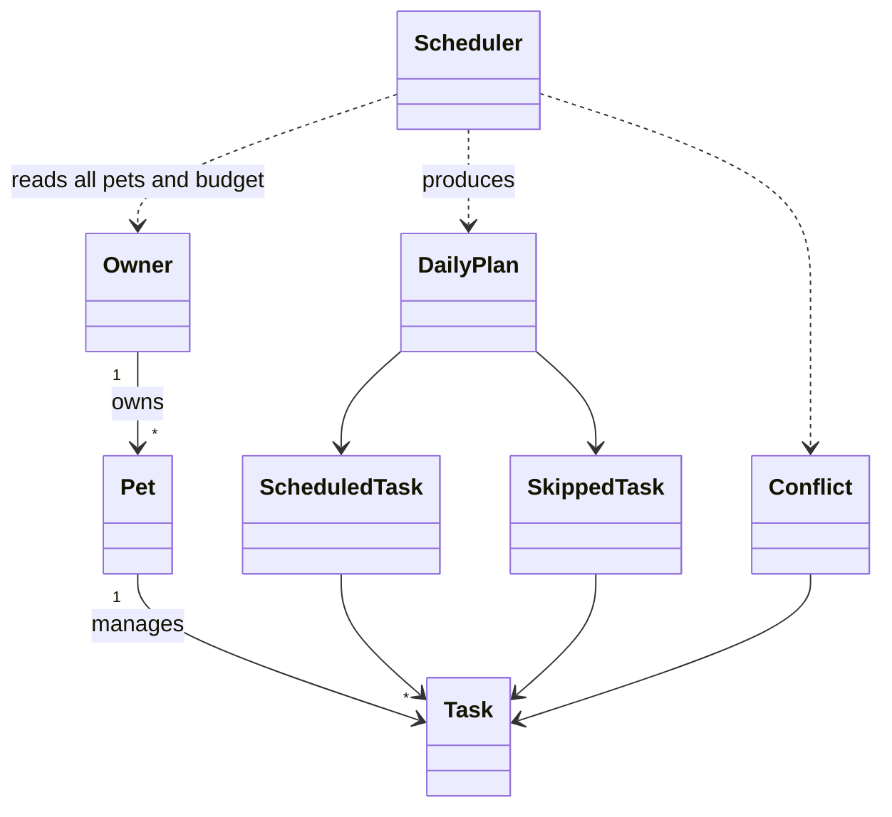

# PawPal+ 🐾

A Python pet-care planner with a Streamlit interface and a reproducible CLI demo.
One owner manages multiple pets, recurring care tasks, and a shared daily time
budget. The scheduler builds a plan and explains anything that cannot fit.

## Run locally

Requires Python 3.10 or newer. Verified with Python 3.13.3.

```bash
git clone https://github.com/Somama12/Assign3.git
cd Assign3
python -m venv .venv
source .venv/bin/activate  # Windows: .venv\Scripts\activate
python -m pip install -r requirements.txt
python main.py
python -m streamlit run app.py
```

The CLI deliberately uses **September 14, 2026**, a Monday, so weekly tasks and
sample output are reproducible. The UI defaults to the current date and allows
choosing a planning date. No API key or AI service is needed to run the app.

## Classes and architecture

| Class | Responsibility |
|---|---|
| `Task` | Description (`title`), duration, priority, frequency, preferred time, due date, completion status, and stable recurrence IDs; `mark_complete()` changes status |
| `Pet` | Name, species, breed, age and task collection; adds, filters, removes and completes tasks |
| `Owner` | Name, available minutes, preferences and multiple pets; household task lookup/filtering and JSON save/load |
| `Scheduler` | Sorts tasks, detects conflicts, plans all pets against one clock/budget and finds a next available slot |
| `DailyPlan`, `ScheduledTask`, `SkippedTask`, `Conflict` | Structured results carrying times, warnings and explanations |

`pawpal_system.py` contains all domain logic and imports no Streamlit.
`main.py` and `app.py` use the same classes. Task, Pet and Owner are dataclasses.
The final Mermaid source is **[diagrams/uml_final.mmd](diagrams/uml_final.mmd)**;
[diagrams/uml.mmd](diagrams/uml.mmd) is the working diagram, also updated.



## Smarter Scheduling

| Feature | Method and behavior |
|---|---|
| Chronological sort | `Scheduler.sort_by_time(tasks)` sorts fixed clock times, with flexible tasks last; pass `owner.all_tasks()` to sort the household |
| Priority sort | `Scheduler.sort_by_priority(tasks)` ranks high → medium → low, then shorter duration; CLI demonstrates it across both pets |
| Filtering | `Owner.filter_tasks(...)` searches every pet by name, status, priority, frequency and due date; supplied criteria combine with AND |
| Recurrence | `Pet.complete_task(task, today)` marks done and queues a fresh daily/weekly occurrence; repeated completion creates no duplicate |
| Undo | `Pet.uncomplete_task(...)` removes the exact pending follow-up using its ID, even after reload or on a different date |
| Conflict detection | `Scheduler.find_conflicts(owner, day)` checks all pairs of fixed-time tasks across pets, comparing full half-open intervals; touching endpoints are allowed |
| Time blocking | `Scheduler.build_plans(owner, day)` places fixed tasks first, then flexible tasks by priority, preferences and duration; one shared clock and budget prevent double booking |
| Next available slot | `Scheduler.next_available_slot(owner, minutes, day)` finds the first contiguous gap after planning **all pets**, subject to remaining budget and day end; returns `None` if none fits |

Fixed tasks are considered by clock time, with priority breaking equal-time ties.
Flexible tasks are ranked by priority across pets. A fixed low-priority task can
therefore reserve time before a flexible high-priority task. The greedy planner
never moves a fixed appointment or claims to find a globally optimal schedule.
Skipped tasks remain visible for the owner to resolve.

Recurrence is based on the completion date: daily means the next day; weekly means
the next configured weekday. Overdue dated tasks remain due. Every task currently
recurs; delete a one-time appointment after completion and remove its follow-up.
The application uses local dates/times, not time zones or overnight planning.

## Demo Walkthrough

1. Open the Streamlit app and add a pet, or choose **Load example data**.
2. Add a second pet and care tasks with durations, priorities and optional fixed times.
3. Set available minutes, preferences and the day window in **Your day**, then **Save**.
4. Use **Show** and **Order by** to filter and sort task rows. **Done** creates the next occurrence; undo removes its pending follow-up.
5. Choose **Plan for** and **Generate schedule**. Review the time tables, totals, conflict warnings and reasons for skipped tasks.
6. Open **Find room for another care task** to see an available slot. This is a suggestion, not a reservation.
7. Choose **Save to JSON** before closing. In a new session, choose **Load saved data** to restore the household.

## Data persistence

`Owner.save_to_json(path)` and `Owner.load_from_json(path)` save and restore the
owner, pets, tasks, enums, ISO dates/times, completion state and recurrence links.
The snapshot has a schema version. Loading constructs fresh dataclass objects;
malformed snapshots produce an error and the UI keeps its current household.
Writing serializes first, writes a temporary file, then replaces the snapshot.

```bash
# Run the worked example and save its final state:
python main.py --save data.json
# A separate process restores the saved household and displays its plan:
python main.py --load data.json
```

The default UI file is `data.json` beside `app.py`. Save/load is explicit; session
state alone does not survive a browser/server restart. Owner preferences and time
budget persist; the scheduler's day window and UI filters do not. Set the
`PAWPAL_DATA_PATH` environment variable to use a different UI snapshot path.
This is a local, single-user snapshot workflow; concurrent writers are not merged.

Files changed for persistence: `pawpal_system.py`, `app.py`, `main.py`,
`tests/test_extensions.py`, `.gitignore`, and both UML files. Personal `data.json`
and its temporary file are ignored by Git.

## Professional output formatting

The CLI uses `section()`, `print_tasks()` and `print_plan()` in `main.py`:
fixed-width f-string columns, section dividers, clock ranges, status markers and
indented explanations. No extra formatting dependency is needed.
The Streamlit UI uses `st.table`, `st.metric`, `st.success`, `st.warning`,
expanders and emoji indicators. Conflict captions reflect the actual generated
plan rather than assuming the first task won.

## Sample CLI output

Actual output of `python main.py` (the fixed date is intentional):

```text
==============================================================
        TODAY'S SCHEDULE - Monday, September 14, 2026
==============================================================
Owner:      Jordan
Time today: 90 min
Prefers:    walk, play
Pets:       Mochi (dog, Shiba Inu, 3y), Pickle (cat, Tabby, 7y)
Conflicts:  none detected

--------------------------------------------------------------
MOCHI
--------------------------------------------------------------
  08:00-08:30  Morning walk     30 min
               high     why: fixed 08:00 slot you asked for
  08:30-08:40  Breakfast        10 min
               high     why: high priority
  18:00-18:25  Evening walk     25 min
               medium   why: fixed 18:00 slot you asked for

  3 tasks, 65 min of care

  Left out:
    - Brush coat      needs 20 min, only 10 min left of your 90
    - Puzzle feeder   needs 15 min, only 10 min left of your 90

--------------------------------------------------------------
PICKLE
--------------------------------------------------------------
  08:40-08:50  Wet food         10 min
               medium   why: medium priority
  09:00-09:05  Thyroid meds      5 min
               high     why: fixed 09:00 slot you asked for

  2 tasks, 15 min of care

  Left out:
    - Wand play       needs 15 min, only 10 min left of your 90
    - Clip nails      needs 25 min, only 10 min left of your 90

--------------------------------------------------------------
  5 tasks planned, 4 left out, 80/90 min used

==============================================================
                   HOUSEHOLD PRIORITY ORDER
==============================================================
    09:00  Thyroid meds      5 min  high
      --    Breakfast        10 min  high
    08:00  Morning walk     30 min  high
      --    Wet food         10 min  medium
      --    Brush coat       20 min  medium
    18:00  Evening walk     25 min  medium
      --    Puzzle feeder    15 min  low
      --    Wand play        15 min  low
      --    Clip nails       25 min  low

==============================================================
                     NEXT AVAILABLE SLOT
==============================================================
  10 min: 08:50
  15 min: no slot within the shared budget

==============================================================
                    SORTING AND FILTERING
==============================================================
Mochi's tasks in the order they were entered:
    18:00  Evening walk     25 min  medium
      --    Puzzle feeder    15 min  low
    08:00  Morning walk     30 min  high
      --    Breakfast        10 min  high
      --    Brush coat       20 min  medium

Scheduler.sort_by_time() - fixed times first, unpinned tasks last:
    08:00  Morning walk     30 min  high
    18:00  Evening walk     25 min  medium
      --    Puzzle feeder    15 min  low
      --    Breakfast        10 min  high
      --    Brush coat       20 min  medium

Scheduler.sort_by_priority() - highest priority, then shortest:
      --    Breakfast        10 min  high
    08:00  Morning walk     30 min  high
      --    Brush coat       20 min  medium
    18:00  Evening walk     25 min  medium
      --    Puzzle feeder    15 min  low

Owner.filter_tasks(pet_name='Pickle') - one pet only:
      --    Wand play        15 min  low
    09:00  Thyroid meds      5 min  high
      --    Clip nails       25 min  low
      --    Wet food         10 min  medium

Owner.filter_tasks(priority='high') - across every pet:
    08:00  Morning walk     30 min  high
      --    Breakfast        10 min  high
    09:00  Thyroid meds      5 min  high

Owner.filter_tasks(completed=False, due_on=PLANNING_DAY) - due today:
    18:00  Evening walk     25 min  medium
      --    Puzzle feeder    15 min  low
    08:00  Morning walk     30 min  high
      --    Breakfast        10 min  high
      --    Brush coat       20 min  medium
      --    Wand play        15 min  low
    09:00  Thyroid meds      5 min  high
      --    Clip nails       25 min  low
      --    Wet food         10 min  medium
    ^ 'Brush coat' is weekly on Monday, so it appears here but would not
      on any other weekday.

==============================================================
                       RECURRING TASKS
==============================================================
Completed 'Breakfast' (daily) on Mon Sep 14
  -> queued: Breakfast (10 min, high, due Tue Sep 15)
Completed 'Brush coat' (weekly) on Mon Sep 14
  -> queued: Brush coat (20 min, medium, due Mon Sep 21)

Mochi's pending list now carries the next occurrences:
    18:00  Evening walk     25 min  medium
      --    Puzzle feeder    15 min  low
    08:00  Morning walk     30 min  high
      --    Breakfast        10 min  high     due Tue Sep 15
      --    Brush coat       20 min  medium   due Mon Sep 21

Still due on Mon Sep 14 (the follow-ups are not):
    18:00  Evening walk     25 min  medium
      --    Puzzle feeder    15 min  low
    08:00  Morning walk     30 min  high

==============================================================
                      CONFLICT DETECTION
==============================================================
Three tasks pinned to overlapping times:
    08:00-08:30  Morning walk    (Mochi)
    08:15-08:25  Insulin shot    (Pickle)
    08:20-08:25  Eye drops       (Pickle)

Scheduler.conflict_warnings() found 3:
    ! 'Morning walk' for Mochi (08:00-08:30) overlaps 'Insulin shot' for Pickle (08:15-08:25) - you cannot be in two places at once
    ! 'Morning walk' for Mochi (08:00-08:30) overlaps 'Eye drops' for Pickle (08:20-08:25) - you cannot be in two places at once
    ! Pickle: 'Insulin shot' (08:15-08:25) overlaps 'Eye drops' (08:20-08:25)

The plan still builds - the loser is skipped, not crashed on:
    kept    08:00  Morning walk (Mochi)
    skipped       Insulin shot (Pickle) - its preferred time overlaps an earlier task
    skipped       Eye drops (Pickle) - its preferred time overlaps an earlier task
```

## Testing PawPal+

```bash
python -m pytest
python -m pytest -q --cov=pawpal_system --cov-report=term-missing
python -m experiments.compare_slot_strategies
```

**108 passing tests** across three files:

- `tests/test_pawpal.py`: 72 domain tests for completion, task/pet collections, sorting, filtering, daily/weekly recurrence, overdue tasks, overlapping intervals, budgets, priorities and cross-pet plans.
- `tests/test_app.py`: 15 Streamlit AppTest checks for adding pets/tasks, reruns, duplicate names/titles, removal, completion/undo, sorting and conflict display.
- `tests/test_extensions.py`: 21 cases for JSON round trips, invalid/missing snapshots, new UI sessions, recurrence identity, next-slot constraints and priority-aware conflict captions.

Actual passing output from the coverage command above:

```text
........................................................................ [ 66%]
....................................                                     [100%]
================================ tests coverage ================================
_______________ coverage: platform darwin, python 3.13.3-final-0 _______________

Name               Stmts   Miss  Cover   Missing
------------------------------------------------
pawpal_system.py     393      5    99%   343, 373, 375, 379, 388
------------------------------------------------
TOTAL                393      5    99%
108 passed in 9.46s
```

**Confidence: ★★★★☆ (4/5).** Tests verify the stated rules and Streamlit behavior;
99% line coverage does not prove all possible inputs or real-world usability.
The app has no multi-user storage, timezone model, or optimal scheduling solver.

## AI workflow and bonus evidence

[ai_interactions.md](ai_interactions.md) records the agent workflow and a
reproducible comparison of minimal versus constraint-focused prompting briefs,
using the same Codex session. It does not claim a second model was consulted.
[reflection.md](reflection.md) preserves the existing reflection and adds this
session's verified changes. The student's personal review/decision remains theirs.

| Bonus | Evidence |
|---|---|
| Advanced algorithm + agent workflow | Public `next_available_slot()` API, CLI/UI use, tests and Agent Workflow log |
| Persistence | Versioned JSON, separate-process CLI restore, UI save/load, round-trip tests |
| Advanced scheduling | Shared time blocking, household priority ordering, overlap warnings and CLI examples |
| Professional output | Structured CLI tables and Streamlit status/table/metric components |
| Prompt comparison | Two strategy briefs, candidate code, executed counterexamples and decision rationale in `ai_interactions.md` |
